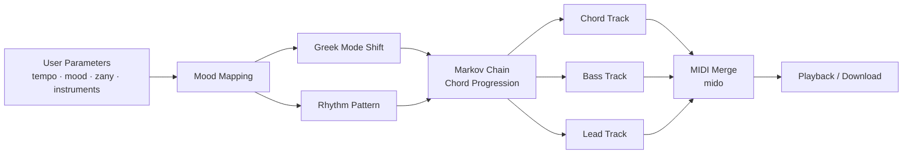

<p align="center">
  
</p>

<h1 align="center">Bach — Procedural Music Generator</h1>

<p align="center">
  <em>Create original music with very little effort, and no AI.</em><br>
  Built at <strong>DawgHack 2025</strong>
</p>

<p align="center">
  
  
  
  
</p>

---

## Overview

**Bach** is a procedural music generator that composes short, multi-instrument MIDI pieces from a few high-level choices: tempo, mood, instrumentation, and how "zany" the result should be. It uses no machine learning. Each piece is built from music theory and probability: a Markov chain picks the chord progression, modal rotation sets the mood, and layered rhythm patterns produce a chord, bass, and lead arrangement.

The goal was to show that music which sounds varied and expressive can come from a small set of clear, understandable rules, with nothing trained on existing songs.

## Features

- **Mood-driven harmony.** Each of seven moods maps to one of the seven Greek modes (Ionian through Locrian) and its own rhythm pattern.
- **Markov-chain chord progressions.** Separate transition tables for major and minor tonalities follow common functional-harmony movement, for example V → I.
- **Three-part arrangement.** Chord, bass, and lead tracks are generated on their own and then merged into a single MIDI file.
- **Probabilistic voicing.** Chords sometimes gain 7ths and 9ths, and random octave shifts keep repeated phrases from sounding mechanical.
- **"Zany" control.** Raises the chance of swapping in chromatically altered chord voicings, so pieces range from conventional to unpredictable.
- **Selectable General MIDI instruments.** Separate options for the chord, bass, and lead voices.
- **One-click randomize.** Picks a random set of parameters and composes a piece from them.
- **Web interface.** Built with Streamlit, with an in-browser MIDI player and one-click `.mid` download.

## How It Works



### 1. Mood → Mode and Rhythm

Each mood selects a modal rotation of the scale and a rhythmic feel for the chords:

| Mood   | Mode       | Tonality | Rhythmic Feel                 |
|--------|------------|----------|-------------------------------|
| Happy  | Ionian     | Major    | Three-halves (dotted) pulse   |
| Cool   | Dorian     | Minor    | Eighth-note stutter           |
| Dark   | Phrygian   | Minor    | One long ambient chord        |
| Dreamy | Lydian     | Major    | Offset whole notes            |
| Funky  | Mixolydian | Major    | Offbeat stabs                 |
| Sad    | Aeolian    | Minor    | Full notes per measure        |
| Tense  | Locrian    | Minor    | Long, sustained chords        |

### 2. Chord Progression Generation

`generateChordProgression.py` builds each phrase as a first-order **Markov chain** over the seven scale degrees. A weighted starting distribution picks the opening chord, and each next chord is drawn from a transition table conditioned on the current one. The major and minor tables are tuned separately to follow typical tonal movement, such as dominant chords resolving to the tonic. A small correction makes immediate repeats less likely.

### 3. Voicing and Variation

Chords are stacked as five-note voicings (root, 3rd, 5th, 7th, 9th). The triad always plays, and the 7th and 9th are added with set probabilities. A "zany" roll sometimes replaces the diatonic voicing with a chromatically altered one, and random octave shifts add contour.

### 4. Arrangement and Output

`main.py` writes three separate MIDI files, one each for chords, bass, and lead, using `MIDIUtil`. The bass and lead parts each pick from a small set of rhythmic and melodic patterns for every chord. `mido` merges the three files into `final_merged_output.mid`, which plays right in the browser through an embedded [html-midi-player](https://github.com/cifkao/html-midi-player) using a General MIDI SoundFont.

### Tempo Ranges

| Setting   | BPM Range |
|-----------|-----------|
| Very Slow | 80–100    |
| Slow      | 100–125   |
| Moderate  | 125–150   |
| Fast      | 150–180   |
| Very Fast | 180–210   |

## Tech Stack

| Layer             | Technology                         |
|-------------------|------------------------------------|
| Language          | Python                             |
| Interface         | Streamlit                          |
| MIDI composition  | MIDIUtil                           |
| MIDI merging      | mido                               |
| Playback          | html-midi-player (Magenta.js)      |
| Experimental      | pyFluidSynth (SoundFont playback)  |

## Project Structure

```
ProceduralMusicGeneratorDawgHack25/
├── app.py                         # Streamlit front end
├── Information.py                 # Parameter model + instrument mappings
├── requirements.txt               # Python dependencies
├── Recources/
│   └── Bach.png                   # Logo
└── src/
    ├── main.py                    # Core composition engine (chords, bass, lead, merge)
    ├── generateChordProgression.py# Markov-chain progressions + mood rhythm patterns
    ├── generateChordRhythm.py     # Rhythm generation (work in progress)
    ├── MIDI Player Test.py        # FluidSynth SoundFont playback experiment
    └── MIDIS/                     # Sample generated MIDI output
```

## Getting Started

### Prerequisites

- Python 3.10 or newer
- `pip`

### Installation

Clone the repository and install the dependencies in a virtual environment. The virtual environment keeps the project's packages separate from your system Python and avoids "externally managed environment" errors on many Linux distributions.

```bash
git clone https://github.com/axudas/ProceduralMusicGeneratorDawgHack25.git
cd ProceduralMusicGeneratorDawgHack25

python3 -m venv .venv
source .venv/bin/activate        # Windows: .venv\Scripts\activate

pip install -r requirements.txt
```

This installs Streamlit, MIDIUtil, and mido. Playback happens in the browser, so no system audio libraries are needed. The player loads its SoundFont from the web, so playback needs an internet connection.

### Running the App

From the project root, with the virtual environment active:

```bash
streamlit run app.py
```

Streamlit opens the app in your browser at `http://localhost:8501`.

To run the app again later, activate the environment first:

```bash
source .venv/bin/activate
streamlit run app.py
```

### Usage

1. Choose a **Tempo** and a **Mood**.
2. Pick instruments for the **Chord**, **Bass**, and **Lead** voices.
3. Set the **Zany** slider to control how unconventional the harmony is.
4. Click **Create**, or click **Randomize** for random parameters.
5. Use the player that appears to listen to the piece, or click **Download** to save it as `bach_song.mid`.

Generated tracks are also written to the project root (`chord1.mid`, `bass1.mid`, `lead1.mid`, `final_merged_output.mid`). These files are ignored by Git.

## Troubleshooting

| Problem | Solution |
|---------|----------|
| `streamlit: command not found` | Activate the virtual environment first with `source .venv/bin/activate`, or run `python -m streamlit run app.py`. |
| `error: externally-managed-environment` when running `pip` | Install inside a virtual environment as shown in [Installation](#installation). |
| The player appears but there is no sound | The player downloads its instrument sounds on first use, so check your internet connection. Some browsers also block audio until you interact with the page, so press play again. |
| `python3 app.py` does nothing useful | Streamlit apps must be started with `streamlit run app.py`. |

## Post-Hackathon Improvements

After DawgHack, the project was cleaned up and hardened:

- Fixed the package import so the app starts reliably from the project root.
- Connected the instrument dropdowns and the **Zany** slider to the generator. Previously the interface ignored them.
- Fixed the lead track, which was using the bass instrument.
- Tempo is now chosen from across each BPM range instead of always using the lowest value.
- Fixed crashes in the "Cool" mood and in rare random rolls. A stress test of 500 randomized pieces now completes with no errors.
- Replaced local `pygame` playback, which needed system MIDI configuration, with an in-browser player.
- Made **Download** export the generated piece.
- Added `requirements.txt`, a Python `.gitignore`, and setup documentation.

## Roadmap

- [ ] Wire the **Jazz** parameter into extended and altered chord choices
- [ ] Generate rhythm on its own in `generateChordRhythm.py`
- [x] Play audio in the browser instead of on the local `pygame` mixer
- [ ] Export to WAV/MP3 using a SoundFont renderer
- [ ] Add a drum/percussion track
- [ ] Let users pick a specific key and phrase length

## Team

Built in a hackathon weekend by:

- **Aidan Carr**
- **Michael See**
- **Justin Dorval**

## Acknowledgments

- DawgHack 2025 for hosting the event
- The authors of [MIDIUtil](https://github.com/MarkCWirt/MIDIUtil), [mido](https://github.com/mido/mido), [html-midi-player](https://github.com/cifkao/html-midi-player), [Magenta.js](https://magenta.tensorflow.org/js), and [Streamlit](https://streamlit.io/)
